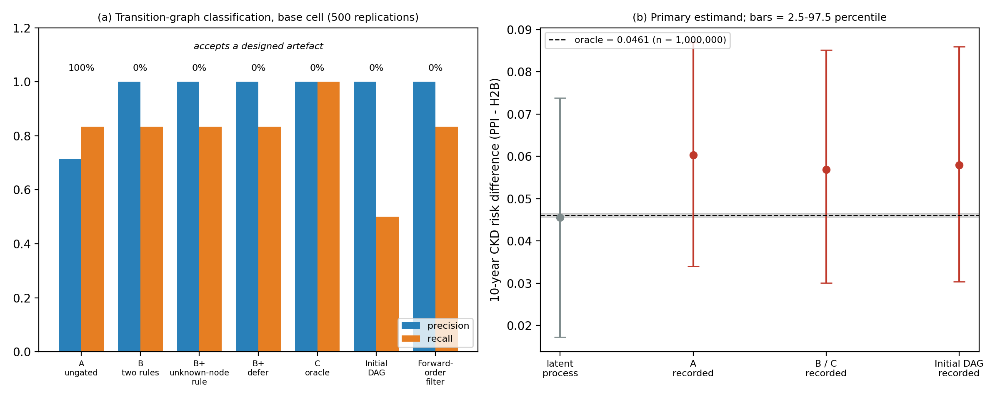

# Closed-Loop Causal Refinement — Ground-Truth Simulation (Manuscript Companion)

Reproducible companion code for the simulation study in *"A Closed-Loop Framework for Knowledge-Based Causal Model Refinement Using Process Mining and Human–AI Governance."*

This repository validates the framework under a **known data-generating process**: a fully specified continuous-time multi-state disease simulator generates data with **deliberately injected observation artefacts**, and the governed loop must recover the true causal DAG while **rejecting the artefacts** that an ungoverned configuration accepts. Because we own the simulator, every ground-truth quantity (true edges, true hazard ratios, true mediated proportion) is known and the framework is graded against it.

> **Open in Colab:** upload `notebooks/closed_loop_simulation.ipynb` to [Google Colab](https://colab.research.google.com/), or after pushing this repo to GitHub use the badge link `https://colab.research.google.com/github/<your-org>/closed-loop-simulation-companion/blob/main/notebooks/closed_loop_simulation.ipynb`.

---

## What the study shows

**This is a known-answer (positive-control) test.** The use case was chosen because its results were already published by the authors; calibration, artefacts and gate rules were written knowing the answer, by people who are not independent of it. It tests whether the machinery can recover known structure, not whether it would find the right structure on a new question. No human or LLM adjudication is simulated.

1. **Transition-graph classification** (not causal-DAG recovery). The two-rule gate (Arm B) rejects the two designed artefacts that the ungated arm accepts; this is guaranteed by construction. A simple forward-order filter ties it in the base cell.
2. **Scenarios the rules were not written for.** A held-out artefact is accepted by the two-rule gate (one extra rule fixes it); true feedback that coincides with the coding artefact is rejected (a three-way *defer* gate sends it to the expert); edge removal, a negative control, a latent common cause and loss to follow-up are evaluated. Rules are frozen before the red-team scenarios, but the scenarios are not blind.
3. **Primary estimand: the IPW-standardised 10-year CKD risk difference** (Aalen-Johansen, death and a CVAE-first event competing), checked against one 1,000,000-patient oracle (0.0460, SE 0.0006). On latent data the estimator is valid (bias -0.0005, bootstrap-interval coverage 0.94). On recorded data the risk difference is 1.24x the oracle and the 95% interval covers it 87% of the time. The inflation is differential detection of CKD (sensitivity 0.94 for PPI vs 0.88 for H2B in the simulator). Graph refinement prevents a small extra bias (ungated minus governed: about 0.0034) and does **not** improve accuracy beyond the best available graph. Count-based visit weighting was removed as invalid; surveillance is analysed by a quantitative bias analysis on detection sensitivity (a sensitivity analysis, not a correction).

### Headline result (base cell: n = 5,000, M = 500 replications)

| Arm | Precision | Recall | Accepts ≥1 designed artefact |
|-----|-----------|--------|------------------------------|
| A ungated | 0.71 | 0.83 | 100% |
| B two-rule gate | 1.00 | 0.83 | 0% |
| B + unknown-node rule | 1.00 | 0.83 | 0% |
| B + three-way (defer) gate | 1.00 | 0.83 | 0% |
| C oracle | 1.00 | 1.00 | 0% |
| Initial DAG only | 1.00 | 0.50 | 0% |
| Forward-order filter (not PC/GES) | 1.00 | 0.83 | 0% |

Structural SDs are 0 (deterministic proposer and gate). Results files: `results/base_cell_results.json`, `replications.csv`, `sweeps.json`/`sweeps.csv`, `oracle_ckd.json`, `benchmark.json`, `environment_freeze.txt`. Run: `python -m closed_loop_sim.run_study 500`, `python -m closed_loop_sim.sweeps`, `python -m closed_loop_sim.benchmark`, `python -m closed_loop_sim.finalize`. The R port has **not** been updated for this revision and is not part of the reported results.

### Figures

| Process map (observed DFG) | DAG refinement (True / A / B) |
|---|---|
|  |  |



---

## The two-layer design

The validity of the study rests on one separation: the **latent disease process** (the truth) is kept strictly apart from the **observation process** (what gets recorded), and the observation layer is where the biases are manufactured.

```
 Latent disease process (dgp.py, truth.py)  ── true causal DAG (the truth)
            │
            ▼
 Observation process (observation.py)        ── visits, detection delays, INJECTED artefacts
            │                                    (decoy S2→S0, coding shift S2→S1, held-out Lab_Reassay)
            ▼
 event log → discovery (pm4py DFG) → refinement (Arm A | B | C) → estimation → metrics
                                              │
                                       graded vs truth.py
```

States: **S0** index/on-drug → **S1** CKD → **S2** CVAE → **S3** Death (absorbing). The two trap edges (`S2→S0` drug-feedback decoy, `S2→S1` reverse coding shift) appear in the recorded log but have **no latent causal intensity** — the governed gate must reject them.

---

## Install

Requires Python ≥ 3.10.

```bash
pip install -e ".[dev]"        # installs numpy, scipy, pandas, pydantic, pm4py, lifelines
python -m pytest closed_loop_sim/tests -v
```

Or, without editable install:

```bash
pip install -r requirements.txt
```

---

## Execution Guide

### 1. Run Performance Benchmarking (Action A33)

Profile execution runtime, peak memory consumption, and hardware metadata across the full cohort scale ($n = 294,734$ trajectories):

```bash
# Full cohort benchmark (n = 294,734 trajectories)
python -m closed_loop_sim.benchmark

# Fast test run (n = 10,000 trajectories)
python -m closed_loop_sim.benchmark --n 10000
```
*Outputs structured metrics to `results/benchmark.json`, explicitly clarifying that the framework operates as a **cycle-based diagnostic workflow** for iterative batched analysis rather than a real-time stream processor.*

### 2. Run Robustness & Challenge Scenarios Sweeps (Actions A10, A12, A22, A24)

Run all factor sweeps (sample size, monitoring differential $\kappa$, timestamp granularity, confounding, artifact rates, support threshold sensitivity $s_{\min}$, and challenge scenarios):

```bash
python -m closed_loop_sim.sweeps
```
*Outputs to `results/sweeps.csv`, `results/sweeps.json`, and `results/figure_sweeps.png`.*

### 3. Run Main Base-Cell Simulation Study (Phase 5)

Execute the full $M = 500$ replication study across base and sensitivity cells:

```bash
python -m closed_loop_sim.run_study 500
```
*Outputs to `results/base_cell_results.json` and `results/replications.csv`.*

### 4. Finalize Manuscript Sections & Summary Figures

Fill manuscript section templates and render final summary figures:

```bash
python -m closed_loop_sim.finalize
python -m closed_loop_sim.visualize
```
*Outputs `results/figure_simulation.png` and `docs/manuscript_simulation_sections_FINAL.md`.*

---

## Interactive Walkthrough & Fast Look

A smaller, faster run for a first look:

```python
from closed_loop_sim.config import base_cell
from closed_loop_sim.experiment import run_cell
from closed_loop_sim.refinement import run_iterative_refinement, MechanicalProposer, RulesGate
from closed_loop_sim.discovery import discover
from closed_loop_sim.eventlog import build_event_log_data

# Run multi-cycle iterative refinement with explicit stopping rules (Action A31)
data = build_event_log_data(5000, base_cell(), seed=42)
disc = discover(data.log, data.visit_counts)
ref_res = run_iterative_refinement(MechanicalProposer(), RulesGate(), disc, max_cycles=5)

print(f"Cycles run: {ref_res.cycles_run}, Stopped reason: {ref_res.stopped_reason}")
print(f"Edges: {ref_res.edges}")
```

See **[docs/TUTORIAL.md](docs/TUTORIAL.md)** for a step-by-step walkthrough, and the **[Colab notebook](notebooks/closed_loop_simulation.ipynb)** to run it interactively.

---

## Repository Layout

```
closed_loop_sim/
  config.py        parameter models + base-cell defaults (pydantic) & challenge scenarios
  dgp.py           latent truth: Weibull-PH hazards, trajectory sampler, population, feedback scenarios
  truth.py         oracle: true DAG, true beta_E, g-computation mediated proportion
  observation.py   visit process, detection delays, artefact injection (decoy, coding shift, held-out Lab_Reassay)
  eventlog.py      assemble the patient-level activity event log
  discovery.py     directly-follows graph (pm4py) + monitoring-stratified evidence & activity mapping
  refinement.py    Proposer/Gate interfaces, Arms A/B/C, Baselines, multi-cycle iterative refinement & stopping rules (A31), backward edge cost metric (A10)
  estimation.py    arm-specific analysis: IPW Aalen-Johansen CIF/RMTL with bootstrap intervals, detection-sensitivity QBA, Cox log-HR (secondary); causal.py: d-separation, propensity/overlap diagnostics, bootstrap
  calibration.py   observed-log Table-4 calibration, propensity diagnostics (SMDs, max weight, ESS) (A17), backdoor set derivation (A18)
  metrics.py       structural metrics graded vs the oracle
  experiment.py    run replications of a cell, Wilson confidence intervals (A23), MCSE aggregation
  benchmark.py     performance benchmarking (n=294,734 trajectories), peak memory profiling & hardware logging (A33)
  sweeps.py        robustness sweeps & challenge scenario benchmarking (A10, A12, A22, A24)
  run_study.py     entry point: run the base cell and write results/
  finalize.py      fill manuscript sections + Phase 4 primary estimand recommendation engine (A15)
  visualize.py     process map + DAG-refinement figures
  tests/           unit + integration tests (38 tests)
docs/
  TUTORIAL.md            step-by-step tutorial
  METHODS_SPEC.md        full simulation specification (the authoritative plan)
  manuscript_sections.md Methods + Results text templates
notebooks/
  closed_loop_simulation.ipynb   Google Colab tutorial notebook
results/
  process_map.png, dag_refinement.png, figure_simulation.png
  base_cell_results.json, replications.csv   (M = 500 archived results)
  benchmark.json                             (n=294,734 demonstrator benchmark results)
  dgp.ttl, process_map.ttl, enhanced_graph.ttl   (RDF Turtle representations)
R/
  closed_loop_sim.R       R port (base R + survival): whole pipeline in one file
  run_study.R             run the study -> results_R/
  test_closed_loop_sim.R  base-R test suite (12 checks)
  tutorial.Rmd            R Markdown walkthrough
  README.md               R-specific guide
```

---

## Also in R

A faithful **R port** for statisticians who work in R lives in [`R/`](R/). It depends only on base R and the **`survival`** package (cause-specific Cox) — the DGP and directly-follows graph are hand-coded, so no niche packages are needed. It reproduces the same headline result (Arm A accepts both artefacts, Arm B rejects both; latent Cox recovers β ≈ 0.25; mediated proportion ≈ 0.46).

```bash
cd R
Rscript test_closed_loop_sim.R     # 12 tests
Rscript run_study.R 100            # -> ../results_R/ (summary, csv, figures)
```

See [`R/README.md`](R/README.md) and [`R/tutorial.Rmd`](R/tutorial.Rmd).

---

## Reproducibility

One master seed (`SeedSequence`) yields deterministic per-replication seeds; the DGP and observation processes use **separate** spawned streams, so the latent truth is invariant to changes in the observation model. The recorded event log is calibrated to the published Table 4 transition-risk pattern (worst absolute discrepancy 0.055 under tolerance 0.08). Software versions and benchmark profiles are recorded in `results/base_cell_results.json` and `results/benchmark.json`.

---

## License

MIT — see [LICENSE](LICENSE).
